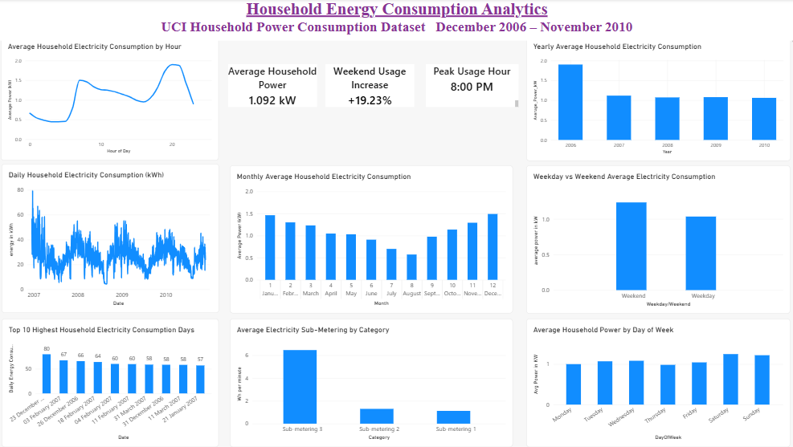

# energy-consumption-analytics
Data analytics portfolio project exploring electricity consumption, peak demand, and energy cost patterns.

## Power BI Dashboard

The Power BI dashboard analyzes household electricity consumption from December 2006 to November 2010 using the UCI Individual Household Electric Power Consumption dataset.

### Dashboard Preview

### Key Insights
- **Average active power:** 1.092 kW.
- **Peak usage hour:** 8:00 PM.
- **Lowest usage hour:** 4:00 AM.
- **Highest average monthly power:** December.
- **Weekend usage:** Average active power was approximately 19.23% higher on weekends than on weekdays.

### Dashboard Visualizations
- Hourly electricity consumption
- Monthly and yearly average power
- Daily electricity consumption trends
- Weekday versus weekend comparison
- Sub-metering analysis
- Top 10 highest-consumption days

*Note: This analysis uses a public household electricity dataset, not readings from a personal energy-monitoring prototype.*
